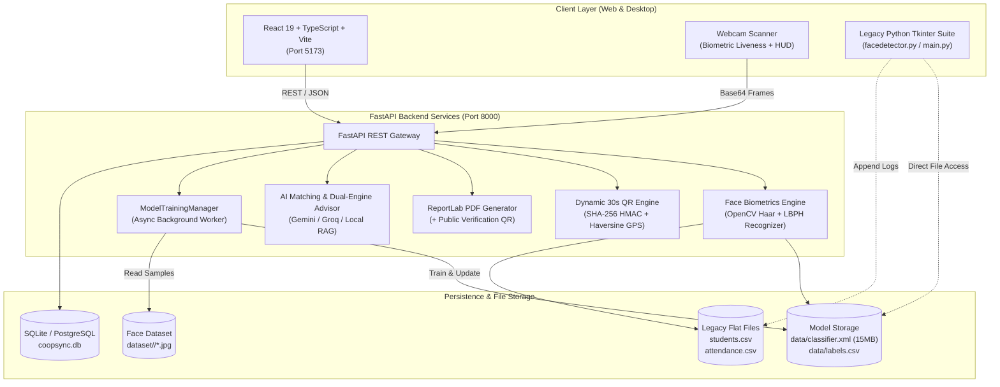

# CoopSync AI – AI-Enabled Cooperative ERP, Biometric Attendance & Employment Ecosystem

[](https://sih.gov.in)
[](https://sih.gov.in)
[](https://fastapi.tiangolo.com)
[](https://react.dev)
[](https://opencv.org)
[](https://www.chartjs.org/)
[](https://developer.mozilla.org/en-US/docs/Web/API/Geolocation_API)
[](https://www.sqlite.org)
[](https://www.docker.com)
[](LICENSE)

---

## 📌 Problem Statement Overview
- **Initiative:** Smart India Hackathon (SIH 2026)
- **Problem Statement ID:** `SIH26087`
- **Theme:** Smart Education / Cooperative Digital Transformation
- **Target Institutions:** National Council for Cooperative Training (NCCT), Institutes of Cooperative Management (ICMs/RICMs), State Cooperative Federations (e.g., AMUL, IFFCO, KRIBHCO), and rural training centers.
- **The Challenge:** Traditional cooperative education and training institutions suffer from paper attendance registers, proxy attendance, siloed student records, unverified paper certificates, lack of automated skill-tracking, and zero direct connectivity to cooperative hiring federations.
- **The Solution:** **CoopSync AI** transforms basic face recognition into an enterprise-grade Cooperative ERP and Employment Ecosystem featuring **Real Browser GPS Geofencing (Haversine formula)**, **Anti-Spoofing Biometrics**, **30-Second Dynamic QR Attendance**, **Interactive Student Performance Graphs**, **LMS Learning Portal**, and **AI Job Placement Matching**.

---

## 🚀 Key Modules & Innovations

### 1. 📍 Real Browser GPS Geofencing (Haversine Formula Verification)
- **Real Device Telemetry:** Uses the browser Geolocation API (`navigator.geolocation.getCurrentPosition`) with `enableHighAccuracy: true` to acquire the student's real physical coordinates and signal accuracy ($\pm X\text{ meters}$).
- **Permission On-Demand:** Location permission is requested **only when the student initiates attendance** (no tracking on page load).
- **Zero-Trust Backend Validation:** Coordinates are sent to `/api/attendance/qr/verify` where the server calculates geodesic distance using the **Haversine formula** ($R = 6,371,000\text{ m}$):
  $$d = 2R \cdot \arcsin\left(\sqrt{\sin^2\left(\frac{\Delta\text{lat}}{2}\right) + \cos(\text{lat}_1)\cos(\text{lat}_2)\sin^2\left(\frac{\Delta\text{lon}}{2}\right)}\right)$$
- **Configurable Campus Geofence (`/api/institution/config`):** Institution administrators can configure campus coordinates, allowed radius ($\le 50\text{m}$ default), and signal accuracy threshold ($\le 100\text{m}$) via UI/API with strict RBAC blocking student tampering.
- **Strict Error Handling & Anti-Tampering:** Rejects out-of-bounds coordinates, poor satellite accuracy, location denial, and out-of-radius attempts with explicit user messages.
- **Offline Attendance GPS Revalidation (Req 14):** Offline records cached on mobile cannot bypass geofence; backend revalidates GPS telemetry upon sync and flags/quarantines invalid records.

### 2. 📈 Student Portal Interactive Performance Graphs
- **Default Student Landing Screen:** Students land directly on **"My Analytics & Graphs"** upon login.
- **75% Statutory Exam Threshold Alert:** Live calculation against NCCT statutory 75% exam attendance guidelines with visual status alert badges.
- **4 Interactive Visual Graphs (Chart.js):**
  1. **Personal Weekly Attendance Trend:** Bar chart tracking attended vs. missed classes across academic weeks.
  2. **Course-Wise Attendance Breakdown:** Doughnut chart breaking down attendance percentages per enrolled engineering and cooperative module.
  3. **Verified Tech Stack & Competency Scores:** Horizontal bar chart rating practical skills from ERP capacity profiles.
  4. **Cooperative Job Placement Match Projections:** Real-time semantic compatibility chart matching student profile to AMUL, IFFCO, and Sahakar openings.
- **Card-Level Graph Modal in Student ERP:** Every student card in the directory has a dedicated **"📊 Graphs"** button allowing students and administrators to inspect interactive charts directly in a modal.

### 3. 📸 AI Face Recognition Biometric Attendance
- **Pretrained LBPH Classifier:** Reuses and upgrades your pre-trained OpenCV LBPH model (`data/classifier.xml`, 15MB) and numeric label mappings (`data/labels.csv`).
- **In-Browser HTML5 Webcam Scanner:** High-framerate webcam capture via `getUserMedia` with interactive HUD reticle, radar sweep animation, and real-time bounding box tracking.
- **Anti-Spoofing & Liveness Telemetry:** Real-time Laplacian variance edge-frequency algorithm preventing 2D photo printouts and mobile screen replay attacks ($> 28.0$ variance threshold).
- **Anti-Duplicate Check-in:** Multi-tier rules ensure a student cannot be recorded as present more than once per calendar day.
- **Desktop OpenCV Bridge:** `/api/attendance/launch-opencv-camera` allows launching the native Python Tkinter detector (`facedetector.py`) directly from the web browser.

### 4. 👤 Integrated Web Face Enrollment & Background Retraining
- **Unified 2-Tab Onboarding in Register Student:**
  - **Tab 1: Academic & Skills Profile:** Student ID, Name, Roll Number, Department, Semester, Degree, and custom Tech Stack chips.
  - **Tab 2: Biometric Webcam Enrollment:** Live webcam preview with oval face alignment guide, multi-angle pose direction prompts (Front, Left, Right, Tilt, Smile), and real-time biometric quality validation:
    - *Sharpness/Blur check:* Rejects frames with Laplacian variance $< 28.0$.
    - *Brightness validation:* Rejects overexposed glare ($> 230$) or underexposed ($< 38$) frames.
    - *Face Centering & Single-Subject Enforcement:* Rejects multi-face frames or out-of-frame positions.
- **High-Speed Auto-Burst:** Captures 50 normalized $200 \times 200$ grayscale face crops saving directly to `dataset/<student_id>/`.
- **Thread-Safe Background Retraining:** Triggers asynchronous LBPH retraining (`/api/model/retrain`) with a non-blocking background thread, real-time progress polling, atomic XML model swapping, and automatic model backup (`classifier.xml.bak`).

### 5. 📱 Dynamic 30-Second TTL Cryptographic QR Attendance
- **Rotating Cryptographic Salt:** Server-generated SHA-256 HMAC payload regenerated every 30 seconds to block screenshot sharing.
- **Animated Circular Countdown:** Real-time synchronized 30s visual countdown ring on instructor displays.
- **Geofenced Campus Boundary:** Enforces a 50-meter GPS perimeter validation around accredited cooperative institutes.
- **Integrated Student Scanner:** Allows students to scan via mobile camera or submit session verification codes with one-time validation per session.

### 6. 🎓 Student ERP & Capacity Building Module
- **Centralized Registry:** Roster tracking Student Cohorts with Roll Numbers, Department, Semester, Attendance Ratio, and Skills tags.
- **75% Attendance Threshold Alert:** Visual ring indicators and amber/red alert badges highlighting students at risk of exam debarment.
- **Card-Level Tech Stack Editor:** Dynamic modal on student cards allowing immediate editing and adding of skills (`Python`, `OpenCV`, `Machine Learning`, `React`, `FastAPI`, `Docker`, `SQL`) with live DB synchronization.

### 7. 📋 Attendance Records Manager & Audit Ledger
- **Full Roster Management:** Search and filter attendance logs by student name, roll number, date range, or check-in method.
- **Status Toggling & Overrides:** Toggle attendance states (`Present`, `Absent`, `Late`, `Excused`) with admin manual override audit notes.
- **GPS Telemetry Audit:** View real device coordinates, signal accuracy, calculated distance from campus, and geofence verification status for every check-in.
- **Bulk Approval & CSV Export:** 1-click batch verification of offline attendance and instant CSV export for institutional archives.

### 8. 📚 Computer Engineering & Cooperative LMS (YouTube Integrated)
- **Curriculum Catalog:** Pre-seeded courses spanning Computer Vision, AI Biometrics, Distributed Systems, Cloud Computing, Cybersecurity, and Cooperative Governance.
- **YouTube Video Integration:** Direct lecture links with clickable `YouTube Link ↗` badge overlays on course cards.
- **One-Click Study Mode:** Prominent `Study ▶` button launching dedicated video player modes.
- **Auto-Extracted Thumbnail Previews:** Automatically extracts YouTube video cover thumbnails (`https://img.youtube.com/vi/<ID>/hqdefault.jpg`) or previews custom image URLs in real time.
- **Course Enrollment Skills Sync:** Enrolling in a course automatically extracts its associated competencies and updates the student's ERP profile and skills tags across the database.

### 9. 📜 Tamper-Proof Digital Certificates (PDF + Verification QR)
- **ReportLab PDF Engine:** Automated generation of publication-grade digital certificates featuring official cooperative borders, dynamic student names, issue dates, and grade distinctions.
- **Public Verification QR Code:** Every certificate embeds a scannable QR code resolving directly to `/api/certificates/verify/{cert_id}` for instant authenticity validation.
- **Instant Printable Download:** One-click PDF download via `/api/certificates/download/{cert_id}`.

### 10. 💼 AI-Enabled Employment & Placement Portal
- **Cooperative Federation Job Board:** Live job postings from cooperative enterprises (AMUL, IFFCO, KRIBHCO, NAFED, State Apex Banks).
- **AI Skill-to-Job Matching Engine:** Algorithmic calculation of candidate profile skills against job requirements, rendering match percentage badges (e.g., *94% Match*).
- **1-Click Application Pipeline:** Direct ERP profile submission updating application statuses to "Shortlisted".

### 11. 📊 Interactive Analytics Dashboard & KPI Metrics
- **Executive Metric Cards:** Real-time counts for Total Registered Students, Today's Attendance %, Course Completion Rate, and Placement Rate.
- **Attendance Consistency Trends:** Weekly comparative Chart.js bar graph comparing present vs. absent ratios.
- **Department Distribution:** Interactive doughnut chart detailing student enrollments across engineering and cooperative disciplines.
- **In-Demand Skills Matrix:** Visual metric bars tracking industry skill demands vs. student cohort capabilities.

### 12. 🤖 CoopSync AI Advisor & Dual-Engine Generative Chatbot
- **Dual-Engine Architecture:** Compiles rich RAG context from live database records, calls Cloud Generative AI APIs (Google Gemini / Groq / OpenRouter) when configured, and falls back seamlessly to a local semantic engine and knowledge bases when offline.
- **In-Browser ⚙️ AI Settings Drawer:** Slide-over settings panel in the chat modal allowing users to connect and test any free API key (e.g. Gemini `AIzaSy...` or Groq `gsk_...`) without restarting servers. Config is synchronized via `/api/ai/config`.
- **Automatic Model Fallback Chains:** Automatically tries backup models (e.g. `gemini-1.5-flash` $\rightarrow$ `gemini-2.0-flash` $\rightarrow$ `gemini-1.5-pro` or `llama-3.3-70b-versatile` $\rightarrow$ `llama-3.1-8b-instant`) if quota or service limits are encountered.
- **Live Wikipedia Educational Fallback:** Zero-key educational fallback via Wikipedia REST API (`fetch_educational_summary`), allowing the assistant to answer general science, biology, physics, and computing queries (*"What is photosynthesis?"*, *"Theory of relativity"*).
- **Built-in Academic Knowledge Bank:** Instant pre-loaded answers for core topics (photosynthesis, Python, OpenCV, cooperatives, Haversine formula, ML).
- **Rich Markdown & Model Attribution:** Renders formatted code blocks, bold text, bullet points, and hyperlinks, displaying the exact model/source badge (e.g. `gemini-1.5-flash`, `llama-3.3-70b`, `Live Wikipedia`) beneath each message.
- **Contextual ERP Answers & Quick Chips:** Instant query chips for common questions (*"How many attendance days do I have?"*, *"Recommend jobs for my tech stack"*, *"Verify my exam eligibility"*).

### 13. ⚡ Offline Attendance Synchronization
- **Resilient Local Queue:** Stores biometric check-ins in browser `localStorage` when network connectivity drops in rural centers.
- **Automatic Batch Sync:** Detects online status restoration and syncs pending records to `/api/attendance/sync-offline`.
- **Backend GPS Revalidation:** Prevents geofence bypass during offline check-ins by verifying stored GPS telemetry upon reconnection.
- **Navbar Sync Counter:** Real-time badge in the top navigation bar alerting users of queued offline check-ins.

### 14. 👥 Multi-Role Access Control (RBAC)
- Supports 5 distinct stakeholder roles with specialized permissions and views:
  1. **Student:** Personal attendance dashboard, course enrollment, certificate downloads, job applications.
  2. **Trainer:** Course authoring, manual attendance marking, classroom progress monitoring.
  3. **Institution Admin:** Student registration, biometric enrollment, certificate issuance, roster overrides.
  4. **NCCT Admin:** High-level national governance, cross-institute KPI metrics, compliance tracking.
  5. **Employer / Recruiter:** Cooperative job posting, reviewing AI-shortlisted student applicants.

### 15. 🖥️ Python Desktop Suite Bridge
- Direct web-based launcher and process manager for the native Python Tkinter desktop applications:
  - `main.py` – Desktop Master Dashboard
  - `facedetector.py` – Native OpenCV Desktop Face Recognition
  - `student.py` – Desktop Student Registration Form
  - `train.py` – Desktop LBPH Classifier Trainer
  - `attendence.py` – Desktop CSV Attendance Table

---

## 🏗️ System Architecture & Workflow



---

## 📂 Project Directory Structure

```
face-recognition-system/
│
├── CoopSyncAI/                                # Enterprise Web Platform & Microservices
│   ├── backend/
│   │   ├── main.py                           # FastAPI core application & REST endpoints
│   │   ├── database.py                       # SQLAlchemy models & Geofence config
│   │   ├── face_engine.py                    # OpenCV LBPH recognition & anti-spoofing engine
│   │   ├── qr_engine.py                      # 30-second TTL dynamic QR & Haversine GPS verification
│   │   ├── certificate_engine.py             # ReportLab PDF certificate & QR generator
│   │   ├── ai_engine.py                      # Skill-job matcher & dual-engine chatbot
│   │   ├── test_gps_attendance.py            # Real GPS geofencing automated test suite
│   │   ├── test_face_enrollment_retrain.py   # Biometric enrollment & retraining test suite
│   │   ├── run_tests.py                      # Unified test runner
│   │   ├── coopsync.db                       # Active SQLite relational database
│   │   ├── requirements.txt                  # Python backend dependencies
│   │   ├── Dockerfile                        # Backend container specification
│   │   └── certificates/                     # Generated PDF certificate storage
│   │
│   ├── frontend/
│   │   ├── src/
│   │   │   ├── components/
│   │   │   │   ├── Navbar.tsx                # Multi-role navigation with "My Analytics & Graphs"
│   │   │   │   ├── LandingPage.tsx           # Public showcase & national overview
│   │   │   │   ├── FaceAttendanceView.tsx    # Live webcam biometric scanner & OpenCV bridge
│   │   │   │   ├── WebFaceEnrollmentModal.tsx# 2-step webcam enrollment & retrain modal
│   │   │   │   ├── QRAttendanceView.tsx      # 30s TTL dynamic QR code & real GPS verification
│   │   │   │   ├── AnalyticsView.tsx         # Student Portal & Admin Chart.js dashboards
│   │   │   │   ├── StudentERPView.tsx        # Student directory with in-place Graph Modals & Tech Stack editor
│   │   │   │   ├── AttendanceManagerView.tsx # Audit ledger, status toggling, GPS telemetry & CSV export
│   │   │   │   ├── CoursesView.tsx           # LMS with video player, thumbnails & skills sync
│   │   │   │   ├── CertificatesView.tsx      # PDF certificate viewer & verification modal
│   │   │   │   ├── EmploymentView.tsx        # Cooperative job portal & AI skill matching
│   │   │   │   ├── ProgrammesView.tsx        # National cooperative training programmes
│   │   │   │   ├── PythonSuiteView.tsx       # Desktop Tkinter process manager
│   │   │   │   └── AIChatModal.tsx           # Dual-engine conversational AI assistant
│   │   │   ├── App.tsx                       # Master view router & application state
│   │   │   ├── api.ts                        # Axios/Fetch API client layer
│   │   │   ├── types.ts                      # TypeScript interfaces & telemetry models
│   │   │   └── index.css                     # Modern glassmorphism CSS design system
│   │   ├── package.json
│   │   ├── tsconfig.json
│   │   └── Dockerfile                        # Frontend container specification
│   │
│   ├── docker-compose.yml                    # Multi-container orchestration
│   └── README.md
│
├── data/
│   ├── classifier.xml                        # Pretrained OpenCV LBPH face model (~15MB)
│   └── labels.csv                            # Numeric ID to student name mappings
│
├── dataset/                                  # Biometric face training samples
│   ├── 5025088/                              # Samples for Puneet
│   ├── 4868448/                              # Samples for Ranjan
│   └── 577575/                               # Samples for Varun
│
├── students.csv                              # Original student database file
├── attendance.csv                            # Original attendance log file
├── facedetector.py                           # Legacy desktop OpenCV face recognition application
├── student.py                                # Legacy desktop student registration GUI
├── train.py                                  # Legacy desktop LBPH model training script
├── attendence.py                             # Legacy desktop attendance viewer
├── main.py                                   # Legacy desktop Tkinter main hub
├── server.py                                 # Root FastAPI server adapter
├── start_coopsync.bat                        # 1-Click Windows Production Launcher
├── PROGRESS.md                               # Granular feature completion checklist
└── README.md                                 # Comprehensive project documentation
```

---

## ⚡ Quick Start Guide

### Prerequisites
- **Python:** 3.9+ installed and in your system `PATH`
- **Node.js:** 18+ and `npm` installed
- **Webcam:** Functioning camera for biometric attendance and enrollment

---

### Option 1: 1-Click Windows Launcher (Recommended)
Simply double-click the included batch launcher in the root directory:
```powershell
start_coopsync.bat
```
*What this does automatically:*
1. Starts the FastAPI backend server on `http://127.0.0.1:8000`.
2. Starts the React Vite frontend development server on `http://localhost:5173`.
3. Opens `http://localhost:5173` directly in your default browser!

---

### Option 2: Manual Terminal Mode

**1. Start the FastAPI Backend:**
```bash
cd CoopSyncAI\backend
pip install -r requirements.txt
python main.py
```
- Backend API: `http://127.0.0.1:8000`
- Swagger Interactive Documentation: `http://127.0.0.1:8000/docs`
- ReDoc API Reference: `http://127.0.0.1:8000/redoc`

**2. Start the React Frontend:**
```bash
cd CoopSyncAI\frontend
npm install
npm run dev
```
- Frontend Web App: `http://localhost:5173`

---

### Option 3: Docker Compose
Run the entire containerized stack with a single command:
```bash
cd CoopSyncAI
docker compose up --build
```
- Frontend: `http://localhost:5173`
- Backend API: `http://localhost:8000`

---

## 🧪 Automated Test Suite

Run the full end-to-end verification suite covering Face Biometrics, Asynchronous Retraining, and Real GPS Geofencing:
```bash
cd CoopSyncAI\backend
python run_tests.py
```

### Verified Test Cases:
- `test_haversine_formula`: Verifies mathematical geodesic distance accuracy.
- `test_institution_config_api`: Validates fetching config and enforcing RBAC on geofence parameters.
- `test_gps_attendance_scenarios`:
  - Reject missing / denied location coordinates.
  - Reject out-of-bounds coordinates ($-90..90$, $-180..180$).
  - Reject poor GPS satellite accuracy ($> 100\text{m}$).
  - Reject student outside campus geofence ($> 50\text{m}$).
  - Accept student inside campus geofence ($\le 50\text{m}$).
  - Block duplicate scan on the same 30s QR session.
  - Block duplicate attendance across the entire calendar day.
- `test_offline_gps_revalidation`: Revalidates offline records upon sync, ensuring unverified records cannot bypass geofence rules.
- `test_attendance_logs_telemetry`: Verifies GPS telemetry (lat, lon, accuracy, distance, status) is recorded in audit logs.
- `test_face_enrollment_retrain`:
  - Health check & model readiness.
  - Role authorization on enrollment endpoints.
  - Biometric quality filters (Laplacian blur $< 28$, underexposed $< 38$, overexposed $> 230$).
  - 50-sample normalization ($200 \times 200$).
  - Thread-safe background retraining with progress polling and rollback backup.

---

## 👥 Demo User Accounts

Switch roles seamlessly via the top-right profile selector:

| User | Role | Key Capabilities |
| :--- | :---: | :--- |
| **Puneet** (`Roll: 2400300100305`, `ID: 5025088`) | `student` | Default landing on **My Analytics & Graphs**, 75% exam warning, dynamic QR check-in with real GPS, course enrollment, certificate download. |
| **Dr. Rajesh Sharma** | `institution_admin` / `admin` | Full ERP directory, Geofence configuration, Attendance Roster with GPS distance telemetry, Web Face Enrollment & retraining. |
| **Dr. Arvind Kumar** | `ncct_admin` | National aggregate analytics, multi-institute capacity governance, audit log exports. |
| **Vikram Mehta** | `trainer` | Attendance management, course creation, classroom progress monitoring. |
| **Pooja Patel** (AMUL) | `employer` | Post cooperative job openings, review AI candidate skill match rankings. |

---

## 🏆 Smart India Hackathon (SIH 2026) Evaluation Highlights

1. **Zero-Trust Physical Presence:**  
   Combines **Real Device GPS Geofencing (Haversine formula)**, **Rotating 30s HMAC QR codes**, and **OpenCV Face Liveness Detection** to make proxy attendance mathematically impossible.
2. **100% Backward Compatibility & Legacy Reuse:**  
   Preserved and elevated 100% of the original OpenCV dataset, Haar Cascades, and LBPH classifier, while expanding into an enterprise-scale full-stack ecosystem with Tkinter desktop launcher bridge.
3. **Beyond Basic Attendance to Capacity Building:**  
   Cooperative transformation requires more than check-ins. The platform provides an end-to-end pathway from classroom biometric attendance, course skill building, and tamper-proof PDF certification to direct cooperative federation employment.
4. **Anti-Spoofing & Rural Resiliency:**  
   Features active Laplacian variance texture analysis to defeat screen and print spoofs, dynamic 30s rotating QR codes as optical backups, and offline queueing with auto-sync and backend GPS revalidation for rural training centers with unreliable internet connectivity.
5. **Modern Design & User Experience:**  
   Built with a glassmorphism design system in React 19, responsive desktop-and-mobile layouts, interactive Chart.js charts, and a dual-engine AI conversational advisor.

---

## 📜 License & Credits
Developed for **Smart India Hackathon 2026** under Problem Statement **SIH26087**.  
Licensed under the [MIT License](LICENSE).
