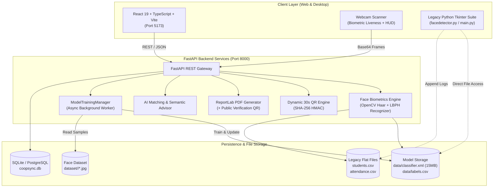

# CoopSync AI – AI-Enabled Cooperative ERP, Biometric Attendance & Employment Ecosystem

[](https://sih.gov.in)
[](https://sih.gov.in)
[](https://fastapi.tiangolo.com)
[](https://react.dev)
[](https://opencv.org)
[](https://www.sqlite.org)
[](https://www.docker.com)
[](LICENSE)

---

## 📌 Problem Statement Overview
- **Initiative:** Smart India Hackathon (SIH 2026)
- **Problem Statement ID:** `SIH26087`
- **Theme:** Smart Education / Cooperative Digital Transformation
- **Target Institutions:** National Council for Cooperative Training (NCCT), Institutes of Cooperative Management (ICMs/RICMs), State Cooperative Federations (e.g., AMUL, IFFCO, KRIBHCO), and rural training centers.
- **The Challenge:** Traditional cooperative education and training institutions suffer from paper attendance registers, proxy attendance, siloed student records, unverified paper certificates, lack of automated skill-tracking, and zero direct connectivity to cooperative hiring federations.
- **The Solution:** **CoopSync AI** transforms legacy face detection into a modern, production-grade Cooperative ERP and Employment Ecosystem. It unifies high-accuracy biometric facial recognition, dynamic anti-proxy QR codes, comprehensive student lifecycle management, an interactive YouTube-integrated LMS, cryptographic tamper-proof digital certificates, and an AI skill-to-job matching employment exchange.

---

## 🚀 Key Modules & Innovations

### 1. 📸 Real-Time AI Face Recognition Attendance
- **Pretrained LBPH Classifier:** Loads and evaluates Haar Cascade + Local Binary Patterns Histograms (`data/classifier.xml` and `data/labels.csv`) with instant identity resolution.
- **In-Browser HTML5 Webcam Scanner:** High-framerate webcam capture via `getUserMedia` with interactive HUD reticle, radar sweep animation, and real-time bounding box tracking.
- **Anti-Spoofing & Liveness Telemetry:** Real-time Laplacian variance edge-frequency filter detecting 2D mobile screen replay attacks, printed photograph spoofing, and low-texture impostors.
- **Anti-Duplicate Check-in:** Backend business rules ensure a student cannot be recorded as present more than once per calendar day.
- **Desktop OpenCV Bridge:** Built-in web trigger launching the native Python Tkinter computer vision application (`facedetector.py`) directly from the browser.

### 2. 👤 Integrated Web Face Enrollment & Background Retraining
- **Unified 2-Tab Onboarding in Register Student:**
  - **Tab 1: Academic & Skills Profile:** Student ID, Name, Roll Number, Department, Semester, Degree, and custom Tech Stack chips.
  - **Tab 2: Biometric Webcam Enrollment:** Live webcam preview with oval face alignment guide, multi-angle pose direction prompts (Front, Left, Right, Tilt, Smile), and real-time biometric quality validation:
    - *Sharpness/Blur check:* Rejects frames with Laplacian variance $< 28.0$.
    - *Brightness validation:* Rejects overexposed glare ($> 230$) or underexposed ($< 38$) frames.
    - *Face Centering & Single-Subject Enforcement:* Rejects multi-face frames or out-of-frame positions.
- **High-Speed Auto-Burst:** Captures 50 normalized $200 \times 200$ grayscale face crops saving directly to `dataset/<student_id>/`.
- **Thread-Safe Background Retraining:** Triggers asynchronous LBPH retraining (`/api/model/retrain`) with a non-blocking background thread, real-time progress polling, atomic XML model swapping, and automatic model backup (`classifier.xml.bak`).

### 3. 📱 Dynamic 30-Second TTL Cryptographic QR Attendance
- **Rotating Cryptographic Salt:** Server-generated SHA-256 HMAC payload regenerated every 30 seconds to block screenshot sharing.
- **Animated Circular Countdown:** Real-time synchronized 30s visual countdown ring on instructor displays.
- **Geofenced Campus Boundary:** Enforces a 50-meter GPS perimeter validation around accredited cooperative institutes.
- **Integrated Student Scanner:** Allows students to scan via mobile camera or submit session verification codes with one-time validation per session.

### 4. 🎓 Student ERP & Capacity Building Module
- **Comprehensive Registry:** Centralized records for student cohorts (`Puneet`, `Ranjan`, `Varun`, `Prakash`, `Riya`, etc.) synchronized with `students.csv` and SQLite DB.
- **75% Attendance Threshold Alert:** Visual ring indicators and amber/red alert badges highlighting students at risk of exam debarment.
- **Card-Level Tech Stack Editor:** Dynamic modal on student cards allowing immediate editing and adding of skills (`Python`, `OpenCV`, `Machine Learning`, `React`, `FastAPI`, `Docker`, `SQL`) with live DB synchronization.

### 5. 📋 Attendance Records Manager & Audit Ledger
- **Full Roster Management:** Search and filter attendance logs by student name, roll number, date range, or check-in method.
- **Status Toggling & Overrides:** Toggle attendance states (`Present`, `Absent`, `Late`, `Excused`) with admin manual override audit notes.
- **Bulk Approval:** One-click bulk verification of pending or offline attendance batches.
- **CSV Data Export:** 1-click export of complete attendance history to CSV for institutional archives.

### 6. 📚 Computer Engineering & Cooperative LMS (YouTube Integrated)
- **Curriculum Catalog:** Pre-seeded courses spanning Computer Vision, AI Biometrics, Distributed Systems, Cloud Computing, Cybersecurity, and Cooperative Governance.
- **YouTube Video Integration:** Direct lecture links with clickable `YouTube Link ↗` badge overlays on course cards.
- **One-Click Study Mode:** Prominent `Study ▶` button launching dedicated video player modes.
- **Auto-Extracted Thumbnail Previews:** Automatically extracts YouTube video cover thumbnails (`https://img.youtube.com/vi/<ID>/hqdefault.jpg`) or previews custom image URLs in real time.
- **Course Enrollment Skills Sync:** Enrolling in a course automatically extracts its associated competencies and updates the student's ERP profile and skills tags across the database.

### 7. 📜 Tamper-Proof Digital Certificates (PDF + Verification QR)
- **ReportLab PDF Engine:** Automated generation of publication-grade digital certificates featuring official cooperative borders, dynamic student names, issue dates, and grade distinctions.
- **Public Verification QR Code:** Every certificate embeds a scannable QR code resolving directly to `/api/certificates/verify/{cert_id}` for instant authenticity validation.
- **Instant Printable Download:** One-click PDF download via `/api/certificates/download/{cert_id}`.

### 8. 💼 AI-Enabled Employment & Placement Portal
- **Cooperative Federation Job Board:** Live job postings from cooperative enterprises (AMUL, IFFCO, KRIBHCO, NAFED, State Apex Banks).
- **AI Skill-to-Job Matching Engine:** Algorithmic calculation of candidate profile skills against job requirements, rendering match percentage badges (e.g., *94% Match*).
- **1-Click Application Pipeline:** Direct ERP profile submission updating application statuses to "Shortlisted".

### 9. 📊 Interactive Analytics Dashboard & KPI Metrics
- **Executive Metric Cards:** Real-time counts for Total Registered Students, Today's Attendance %, Course Completion Rate, and Placement Rate.
- **Attendance Consistency Trends:** Weekly comparative Chart.js bar graph comparing present vs. absent ratios.
- **Department Distribution:** Interactive doughnut chart detailing student enrollments across engineering and cooperative disciplines.
- **In-Demand Skills Matrix:** Visual metric bars tracking industry skill demands vs. student cohort capabilities.

### 10. 🤖 CoopSync AI Advisor (Context-Aware Chatbot)
- **Semantic Intelligence Engine:** Natural language query processor interrogating live SQLite ERP database records.
- **Immediate Answers:** Responds to student queries such as *"How many attendance days do I have?"*, *"Recommend jobs for my tech stack"*, and *"Verify my certificate eligibility"*.
- **Quick-Prompt Chips:** Pre-configured query buttons for instant answers.

### 11. ⚡ Offline Attendance Synchronization
- **Resilient Local Queue:** Stores biometric check-ins in browser `localStorage` when network connectivity drops in rural centers.
- **Automatic Batch Sync:** Detects online status restoration and syncs pending records to `/api/attendance/sync-offline`.
- **Navbar Sync Counter:** Real-time badge in the top navigation bar alerting users of queued offline check-ins.

### 12. 👥 Multi-Role Access Control (RBAC)
- Supports 5 distinct stakeholder roles with specialized permissions and views:
  1. **Student:** Personal attendance dashboard, course enrollment, certificate downloads, job applications.
  2. **Trainer:** Course authoring, manual attendance marking, classroom progress monitoring.
  3. **Institution Admin:** Student registration, biometric enrollment, certificate issuance, roster overrides.
  4. **NCCT Admin:** High-level national governance, cross-institute KPI metrics, compliance tracking.
  5. **Employer / Recruiter:** Cooperative job posting, reviewing AI-shortlisted student applicants.

### 13. 🖥️ Python Desktop Suite Bridge
- Direct web-based launcher and process manager for the legacy Python Tkinter desktop applications:
  - `main.py` – Desktop Master Dashboard
  - `facedetector.py` – Native OpenCV Desktop Face Recognition
  - `student.py` – Desktop Student Registration Form
  - `train.py` – Desktop LBPH Classifier Trainer
  - `attendence.py` – Desktop CSV Attendance Table

---

## 🏗️ System Architecture & Workflow



---

## 📂 Project Directory Structure

```
face-recognition-system/
│
├── CoopSyncAI/                                # Enterprise Web Platform & Microservices
│   ├── backend/
│   │   ├── main.py                           # FastAPI core application & REST endpoints
│   │   ├── database.py                       # SQLAlchemy models (User, Attendance, Course, etc.)
│   │   ├── face_engine.py                    # OpenCV LBPH recognition & anti-spoofing engine
│   │   ├── qr_engine.py                      # 30-second TTL dynamic QR session generator
│   │   ├── certificate_engine.py             # ReportLab PDF certificate & QR generator
│   │   ├── ai_engine.py                      # Skill-job matcher & semantic ERP chatbot
│   │   ├── coopsync.db                       # Active SQLite relational database
│   │   ├── requirements.txt                  # Python backend dependencies
│   │   ├── Dockerfile                        # Backend container specification
│   │   ├── test_face_enrollment_retrain.py   # Comprehensive backend integration test suite
│   │   └── certificates/                     # Generated PDF certificate storage
│   │
│   ├── frontend/
│   │   ├── src/
│   │   │   ├── components/
│   │   │   │   ├── Navbar.tsx                # Role-switcher, offline badge & navigation
│   │   │   │   ├── LandingPage.tsx           # Public showcase & national overview
│   │   │   │   ├── FaceAttendanceView.tsx    # Live webcam biometric scanner & OpenCV bridge
│   │   │   │   ├── WebFaceEnrollmentModal.tsx# 2-step webcam enrollment & retrain modal
│   │   │   │   ├── QRAttendanceView.tsx      # 30s TTL dynamic QR code & student scanner
│   │   │   │   ├── StudentERPView.tsx        # Student directory & tech stack editor
│   │   │   │   ├── AttendanceManagerView.tsx # Audit ledger, status toggling & CSV export
│   │   │   │   ├── CoursesView.tsx           # LMS with video player, thumbnails & skills sync
│   │   │   │   ├── CertificatesView.tsx      # PDF certificate viewer & verification modal
│   │   │   │   ├── EmploymentView.tsx        # Cooperative job portal & AI skill matching
│   │   │   │   ├── AnalyticsView.tsx         # KPI metrics, Chart.js trends & skills matrix
│   │   │   │   ├── ProgrammesView.tsx        # National cooperative training programmes
│   │   │   │   ├── PythonSuiteView.tsx       # Legacy desktop Tkinter process manager
│   │   │   │   └── AIChatModal.tsx           # Context-aware AI ERP advisor chatbot
│   │   │   ├── App.tsx                       # Master view router & application state
│   │   │   ├── api.ts                        # Axios/Fetch API client layer
│   │   │   └── index.css                     # Modern glassmorphism CSS design system
│   │   ├── package.json
│   │   ├── tsconfig.json
│   │   └── Dockerfile                        # Frontend container specification
│   │
│   ├── docker-compose.yml                    # Multi-container orchestration
│   ├── coopsync_workflow.jpg                 # Architecture visual blueprint
│   ├── ABSTRACT.pdf                          # SIH submission abstract
│   └── PROGRESS.md                           # Granular feature completion checklist
│
├── data/
│   ├── classifier.xml                        # Pretrained OpenCV LBPH face model (~15MB)
│   └── labels.csv                            # Numeric ID to student name mappings
│
├── dataset/                                  # Biometric face training samples
│   ├── 5025088/                              # Samples for Puneet
│   ├── 4868448/                              # Samples for Ranjan
│   └── 577575/                               # Samples for Varun
│
├── students.csv                              # Original student database file
├── attendance.csv                            # Original attendance log file
├── facedetector.py                           # Legacy desktop OpenCV face recognition application
├── student.py                                # Legacy desktop student registration GUI
├── train.py                                  # Legacy desktop LBPH model training script
├── attendence.py                             # Legacy desktop attendance viewer
├── main.py                                   # Legacy desktop Tkinter main hub
├── server.py                                 # Root FastAPI server adapter
├── start_coopsync.bat                        # 1-Click Windows Production Launcher
└── README.md                                 # Comprehensive project documentation
```

---

## ⚡ Quick Start Guide

### Prerequisites
- **Python:** 3.9+ installed and in your system `PATH`
- **Node.js:** 18+ and `npm` installed
- **Webcam:** Functioning camera for biometric attendance and enrollment

---

### Option 1: 1-Click Windows Launcher (Recommended)
Simply double-click the included batch launcher in the root directory:
```powershell
start_coopsync.bat
```
*What this does automatically:*
1. Starts the FastAPI backend server on `http://127.0.0.1:8000`.
2. Starts the React Vite frontend development server on `http://localhost:5173`.
3. Opens `http://localhost:5173` directly in your default browser!

---

### Option 2: Manual Terminal Mode

**1. Start the FastAPI Backend:**
```bash
cd CoopSyncAI\backend
pip install -r requirements.txt
python main.py
```
- Backend API: `http://127.0.0.1:8000`
- Swagger Interactive Documentation: `http://127.0.0.1:8000/docs`
- ReDoc API Reference: `http://127.0.0.1:8000/redoc`

**2. Start the React Frontend:**
```bash
cd CoopSyncAI\frontend
npm install
npm run dev
```
- Frontend Web App: `http://localhost:5173`

---

### Option 3: Docker Compose
Run the entire containerized stack with a single command:
```bash
cd CoopSyncAI
docker compose up --build
```
- Frontend: `http://localhost:5173`
- Backend API: `http://localhost:8000`

---

### Option 4: Legacy Desktop Tkinter GUI
You can also launch the original desktop interface directly:
```bash
python main.py
```
Or launch individual desktop tools:
- Face Detector: `python facedetector.py`
- Student Registration: `python student.py`
- Model Trainer: `python train.py`
- Attendance Viewer: `python attendence.py`

---

## 🔌 Core REST API Reference

| Endpoint | Method | Description |
| :--- | :---: | :--- |
| `/api/health` | `GET` | Health check, model status, and cached student count |
| `/api/auth/login` | `POST` | Authenticate student, trainer, or administrator |
| `/api/students` | `GET` | Fetch all registered students with attendance rates & skills |
| `/api/students/add` | `POST` | Register a new student into DB & `students.csv` |
| `/api/students/{id}` | `PUT` / `DELETE` | Update profile / delete student and biometric samples |
| `/api/students/capture-sample` | `POST` | Validate and store face sample ($200 \times 200$ grayscale) |
| `/api/students/{id}/samples-count` | `GET` | Retrieve number of enrolled biometric samples |
| `/api/model/retrain` | `POST` | Asynchronously retrain LBPH face classifier in background |
| `/api/model/retrain/status` | `GET` | Poll background retraining progress and status |
| `/api/attendance/face-recognize` | `POST` | Real-time face recognition with anti-spoofing validation |
| `/api/attendance/qr-session` | `GET` | Generate dynamic 30-second TTL attendance QR code |
| `/api/attendance/qr-verify` | `POST` | Validate student dynamic QR code scan with geofencing |
| `/api/attendance/sync-offline` | `POST` | Batch synchronize offline attendance check-ins |
| `/api/attendance/records` | `GET` | Query complete attendance records with filters |
| `/api/attendance/mark-manual` | `POST` | Admin manual attendance override with audit trail |
| `/api/courses` | `GET` / `POST` | List courses / create course with YouTube link & thumbnail |
| `/api/courses/{id}/enroll` | `POST` | Enroll in course and auto-sync domain skills to ERP profile |
| `/api/certificates` | `GET` / `POST` | List issued certificates or issue new credential |
| `/api/certificates/download/{id}` | `GET` | Download tamper-proof PDF certificate with embedded QR |
| `/api/certificates/verify/{id}` | `GET` | Public certificate verification endpoint |
| `/api/jobs` | `GET` / `POST` | View cooperative job openings or post new role |
| `/api/jobs/apply` | `POST` | 1-click apply with automated AI skill-match calculation |
| `/api/ai/chat` | `POST` | Query conversational CoopSync AI advisor on ERP data |
| `/api/python-suite/launch/{app}`| `POST` | Launch native desktop Python Tkinter applications |

---

## 🧪 Testing & Verification Suite

A comprehensive verification test script is included in `CoopSyncAI/backend/test_face_enrollment_retrain.py`. It rigorously tests all newly implemented biometric and training pipelines:

```bash
cd CoopSyncAI\backend
python test_face_enrollment_retrain.py
```

**Test Coverage:**
1. ✅ **Health check:** Verifies model in-memory readiness.
2. ✅ **Role Authorization:** Validates that unauthorized roles cannot enroll faces or trigger retraining.
3. ✅ **Biometric Quality Filters:** Verifies rejection of dark images, overexposed images, and blurred frames ($< 28$ Laplacian variance).
4. ✅ **Valid Face Sample Ingestion:** Simulates valid face capture and confirms normalization to $200 \times 200$.
5. ✅ **Asynchronous Retraining Pipeline:** Triggers background LBPH retraining, polls progress from 10% to 100%, and verifies atomic model file swapping.
6. ✅ **Post-Retrain Recognition:** Confirms the updated classifier immediately recognizes newly enrolled biometric samples.

---

## 🏆 Smart India Hackathon (SIH 2026) Evaluation Highlights

1. **100% Backward Compatibility & Legacy Reuse:**  
   Unlike solutions that discard prior work, CoopSync AI preserved and elevated 100% of the original OpenCV dataset, Haar Cascades, and LBPH classifier, while expanding into an enterprise-scale full-stack ecosystem.
2. **Beyond Basic Attendance to Capacity Building:**  
   Cooperative transformation requires more than check-ins. The platform provides an end-to-end pathway from classroom biometric attendance, course skill building, and tamper-proof PDF certification to direct cooperative federation employment.
3. **Anti-Spoofing & Rural Resiliency:**  
   Features active Laplacian variance texture analysis to defeat screen and print spoofs, dynamic 30s rotating QR codes as optical backups, and offline queueing with auto-sync for rural training centers with unreliable internet connectivity.
4. **Modern Design & User Experience:**  
   Built with a glassmorphism design system in React 19, responsive desktop-and-mobile layouts, interactive charts, and an AI semantic advisor assistant.

---

## 📜 License & Credits
Developed for **Smart India Hackathon 2026** under Problem Statement **SIH26087**.  
Licensed under the [MIT License](LICENSE).
